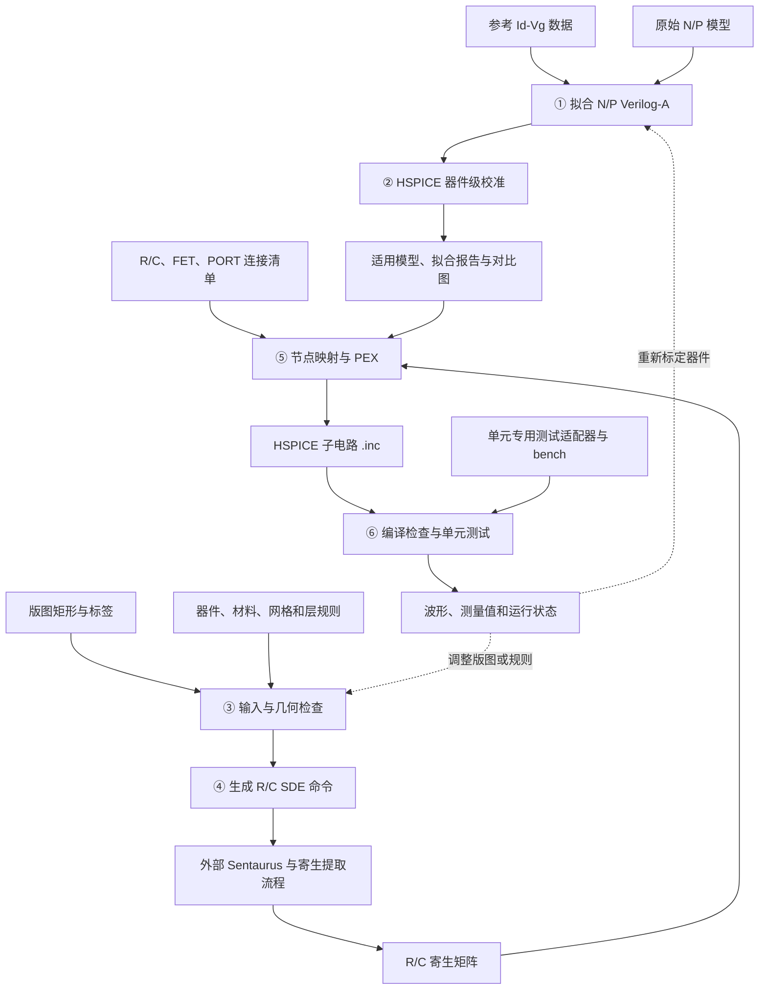
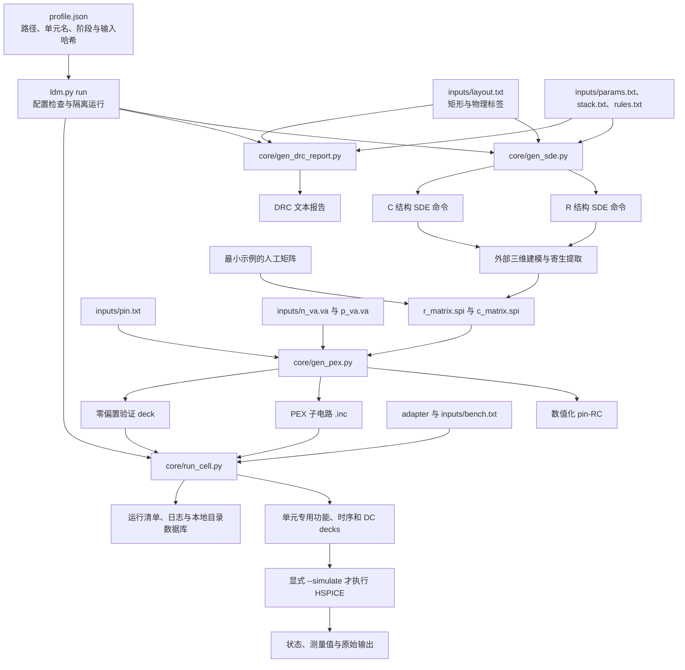
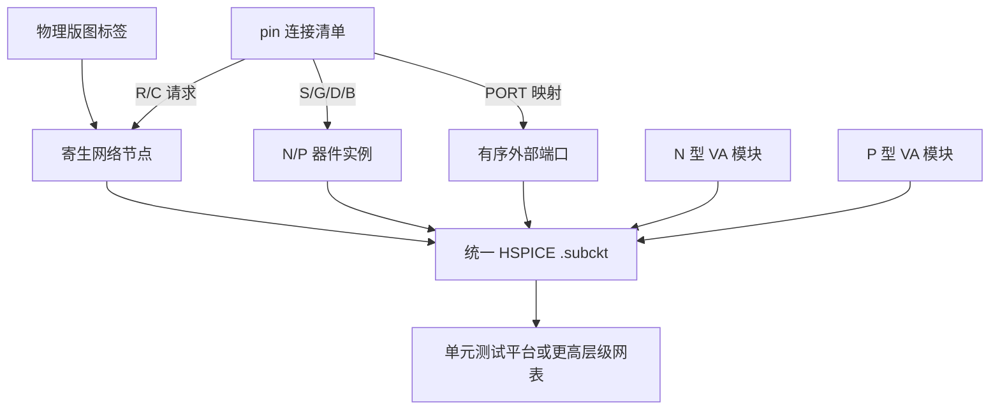
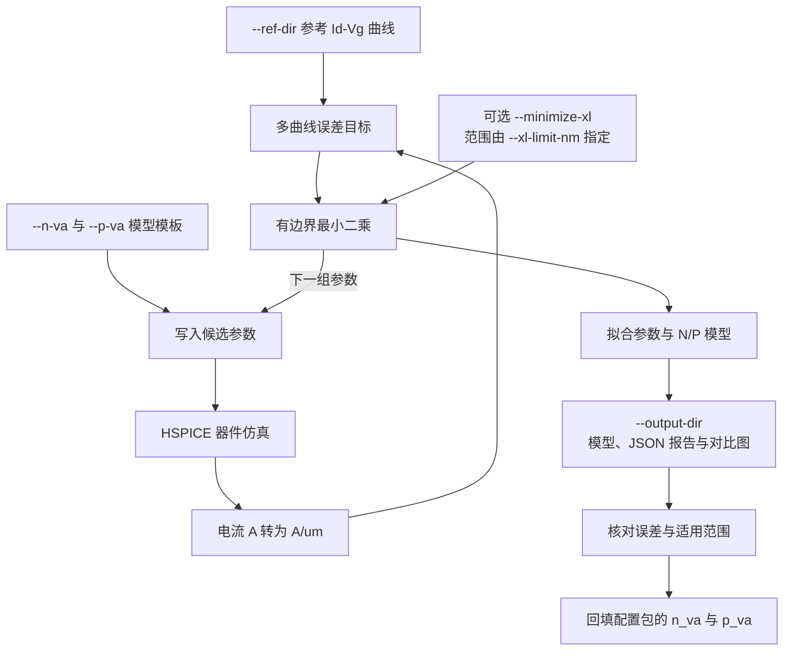
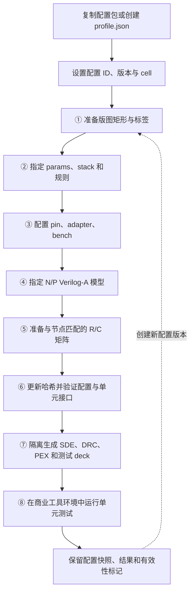

# AutoLDM：框架与最小验证

本目录是唯一的上传边界。框架、标准单元生成资源、一个 INV 最小配置和自动检查均在此目录内；不依赖原来的 `AutoLDM/FLOW`。Python 3.10+ 即可完成最小生成验证。

AutoLDM 面向 DTCO 研究，将器件模型标定、版图与工艺描述、三维建模、寄生参数映射和标准单元验证连接起来。以下保留原 README 的五类框图，并按当前目录与配置包接口更新。

## 总体流程



器件模型标定由 `core/fit_hspice_va.py` 负责，互连和电路验证由其余公共生成器与单元适配器负责。更换标准单元时，主要替换输入和测试适配器。当前统一入口生成 SDE 命令，Sentaurus 与寄生提取仍需在外部配置执行；最小示例直接使用人工 RC 矩阵。

## 输入、处理和产物

`configs/minimal_inv/profile.json` 为每项输入声明路径及 SHA256；`ldm.py run` 检查配置、复制输入快照并调用公共脚本。



| 阶段 | 当前实现 | 主要职责 |
|---|---|---|
| 版图转换 | `core/gds2txt.py`、`core/txt2gds.py` | GDS 与矩形文本描述转换 |
| 几何预检查与三维输入 | `core/gen_sde.py` | 检查输入并生成 R/C SDE 命令 |
| DRC | `core/gen_drc_report.py` | 宽度、间距、包围和接触检查 |
| 寄生映射与 PEX | `core/gen_pex.py` | 计算 pin 级 R/C，生成子电路及验证 deck |
| 标准单元测试 | 配置包的 `adapter` 与 `bench` | 生成单元专用 deck、执行并分析测试 |
| 电路统一执行 | `core/run_cell.py` | 检查单元接口、控制顺序并传播失败状态 |
| 配置与记录 | `tools/workspace.py` | 解析配置包、保存快照、登记运行与结果 |

默认生成模式到 deck 生成结束，不调用 HSPICE；`--dry-run` 检查调度，`--simulate` 才执行仿真。

## 标准单元拓扑为什么可以泛化

电路连接由 `pin` 清单的 `(R)`、`(C)`、`(FET)`、`(PORT)` 四部分表达，公共 PEX 生成器读取这些描述来构建子电路。物理标签与电路端口通过清单显式关联。



实例以 N/P 前缀选择对应器件模型，S/G/D/B 及端口顺序由清单指定；`L/W/NF=default` 从模型解析。改变端口或器件数量，需要同步维护连接清单、矩阵、测试条件和适配器。当前版图以轴对齐矩形为主，DRC 仅覆盖已实现的规则类型；这些约定不代表工艺签核。

## Verilog-A 拟合流程

`core/fit_hspice_va.py` 接受参考曲线目录、N/P 模型模板和输出目录，使用有边界最小二乘调用 HSPICE 评估候选参数。参考电流密度按 A/μm 组织，仿真电流转换到相同口径后计算误差。



旧版 README 中两套历史拟合结果的目录不再作为当前软件依赖；其来源可在 [历史文件说明](docs/history.md) 指向的提交中查阅。拟合需要实际参考数据、可选科学计算依赖及 HSPICE，最小验证不会执行拟合。

## 新建或替换标准单元配置



同一单元的变体可通过 `fork` 创建独立输入包。新单元须保证 `cell`、适配器的 `CELL_ID`、连接清单、bench 和矩阵一致；`resources/standard_cells/` 提供 30 个组合单元的生成资源，仍需匹配版图和提取数据。配置继承和替换规则见 [配置说明](docs/configuration.md)。

## 仓库目录结构

```text
ldm.py                 统一入口
core/                  SDE、DRC、PEX、HSPICE 调度、GDS 转换及可选模型拟合
adapters/inv.py         最小 INV 测试适配器
configs/minimal_inv/    完整可携带的输入包及 SHA256
resources/standard_cells/ 30 个组合标准单元的生成资源
tests/                 配置替换、继承、隔离运行、失败记录和最小回归
tools/                 配置管理与本地 SQLite 索引
```

## 开始使用

在本目录执行（Windows 可直接使用自带启动脚本）：

```powershell
.\Run-LDM.ps1 list
.\Run-LDM.ps1 validate configs/minimal_inv/profile.json
.\Run-LDM.ps1 run configs/minimal_inv/profile.json
.\Run-LDM.ps1 self-test
```

其他系统或已配置 Python 时，等价入口为 `python -B ldm.py ...`。

默认只生成 SDE 命令、DRC 报告、PEX 子电路和四个 INV 测试 deck，不调用商业工具。所有输出进入同级 `LDM_local/runs/`，每次运行有独立编号、输入和框架快照、日志与清单。`--dry-run` 检查调度而不执行仿真；只有显式 `--simulate` 才调用 HSPICE：

```powershell
.\Run-LDM.ps1 run configs/minimal_inv/profile.json --dry-run
.\Run-LDM.ps1 run configs/minimal_inv/profile.json --simulate --hspice-cmd C:/your/hspice.com
```

许可证通过机器环境变量 `SNPSLMD_LICENSE_FILE` 配置，不要写入上传的配置。当前入口生成 SDE 输入，不自动执行 Sentaurus 或寄生提取；真实 R/C 矩阵须由提取流程提供，再替换输入包中的矩阵文件。

最小示例使用人工设定 RC，仅用于验证文件契约、节点映射和生成流程。生成成功、dry-run 完成与物理性能验证是不同状态。真实 HSPICE、Sentaurus、拟合和工艺有效性需要对应环境单独验证。

## 切换和替换配置

```powershell
.\Run-LDM.ps1 list --repository ../LDM_local/configs
.\Run-LDM.ps1 run ../LDM_local/configs/nand2_backend/profile.json
.\Run-LDM.ps1 fork configs/minimal_inv/profile.json ../LDM_local/configs/inv_variant --id inv_variant
```

有新文件时，可在创建新包时替换任意角色，并自动计算新校验值：

```powershell
.\Run-LDM.ps1 fork configs/minimal_inv/profile.json ../LDM_local/configs/inv_newrc --id inv_newrc --set r_matrix=C:/data/new_r.spi --set c_matrix=C:/data/new_c.spi
```

该操作复制全部输入，得到独立、可移动的配置包，不修改源包。已有文件直接改动会触发校验失败；应创建新包或更新包版本和对应 SHA256，保留已经用于实验的版本。适配脚本也是输入的一部分，仅运行可信来源的配置包。

配置包字段、继承和分层替换规则见 [配置说明](docs/configuration.md)。输入依赖都通过清单声明，禁止依靠当前目录下碰巧存在的旧文件。

## 本地数据库与上传

```powershell
.\Run-LDM.ps1 catalog
.\Run-LDM.ps1 catalog --kind configs
.\Run-LDM.ps1 catalog --kind legacy --query sram
.\Run-LDM.ps1 backup-catalog ../LDM_local/backups/catalog-20261110.sqlite
.\Run-LDM.ps1 reindex
.\Run-LDM.ps1 audit-release
.\Run-LDM.ps1 export ../LDM_local/exports/AutoLDM-release.zip
```

`LDM_local/catalog/ldm.sqlite` 保存配置版本、运行、阶段、文件哈希和指标行；旧实验以集合和原始汇总记录登记，不为缺失的历史来源编造版本信息。数据库重建命令从运行清单恢复运行索引，历史集合由本地迁移脚本重新登记。数据库只在本机写入，不要让同步客户端同步正在写入的 SQLite 文件。

只把本目录内容用于更新 GitHub AutoLDM。`export` 排除 `.git`，检查缓存、日志、数据库和外部配置依赖，并生成可直接审阅的压缩包；不会执行 Git 推送。旧目录已从当前版本移出，历史提交仍保留，迁移对应关系见 [历史文件说明](docs/history.md)。

`.gitignore` 只控制 Git。若需要排除 OneDrive/坚果云等文件同步，请在相应客户端排除 `LDM_local`，或通过 `--local-root D:/LDM_local` 将数据放到同步根目录之外。

可选依赖见 `requirements-optional.txt`。模型拟合入口支持 `--ref-dir`、`--n-va`、`--p-va`、`--output-dir`；拟合结果必须输出到本目录外。实际模型拟合需要 NumPy、SciPy、Matplotlib、HSPICE 及真实参考数据。

提交前执行 `python -B tools/check_repository.py` 和最小测试，具体规则见 [开发与提交说明](docs/contributing.md)。源码采用 LF 换行，确保配置文件的字节级校验在不同系统保持一致。第三方模型保留原版权说明，本次整理未新增全仓库许可证。
