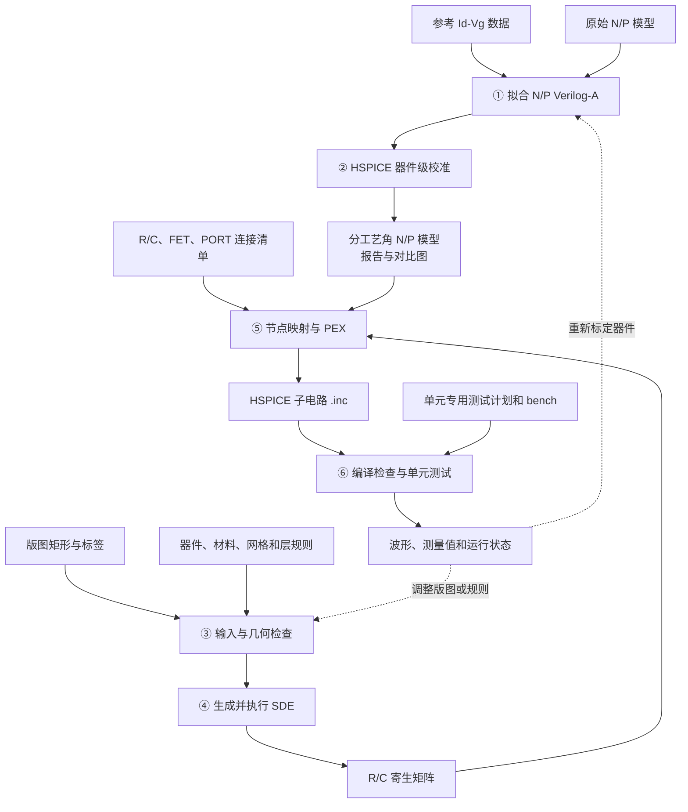
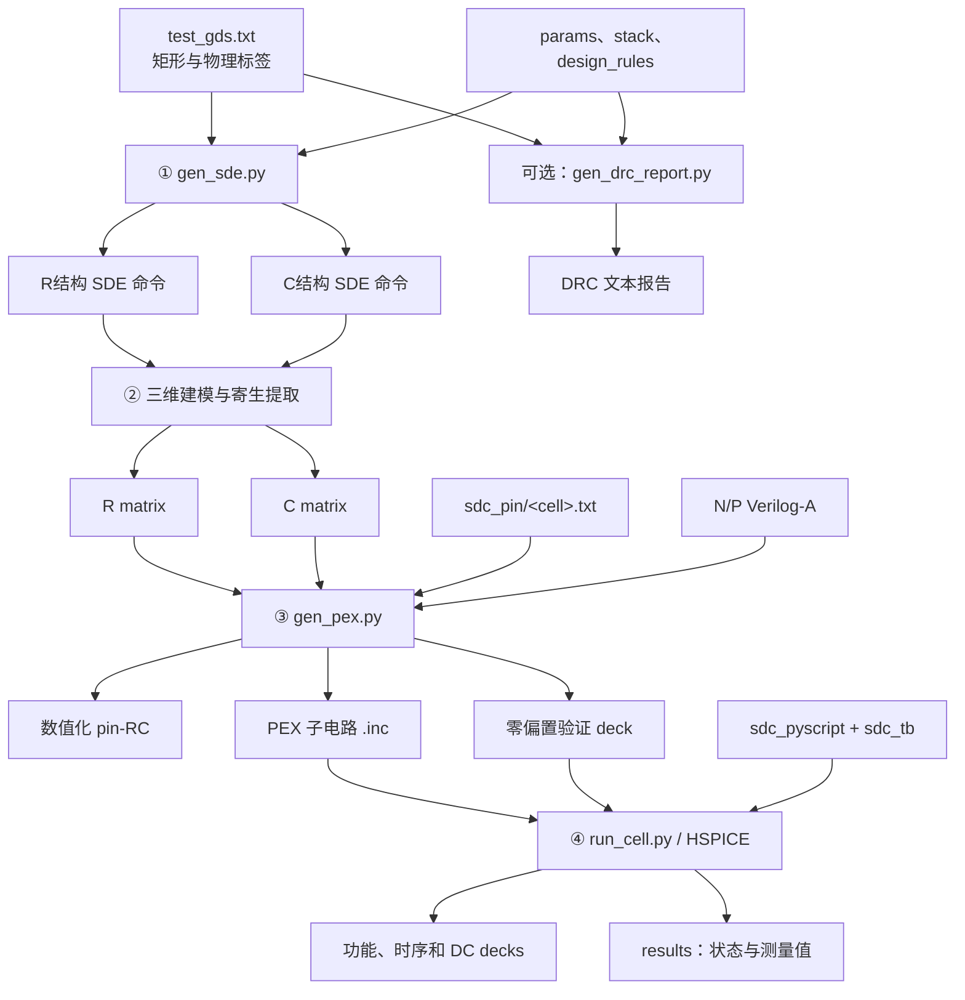
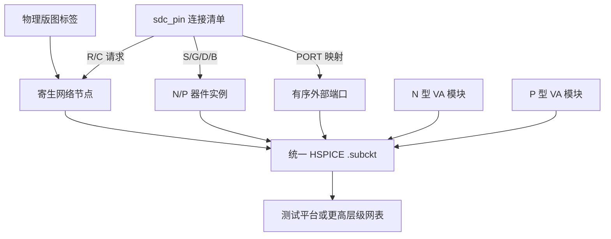
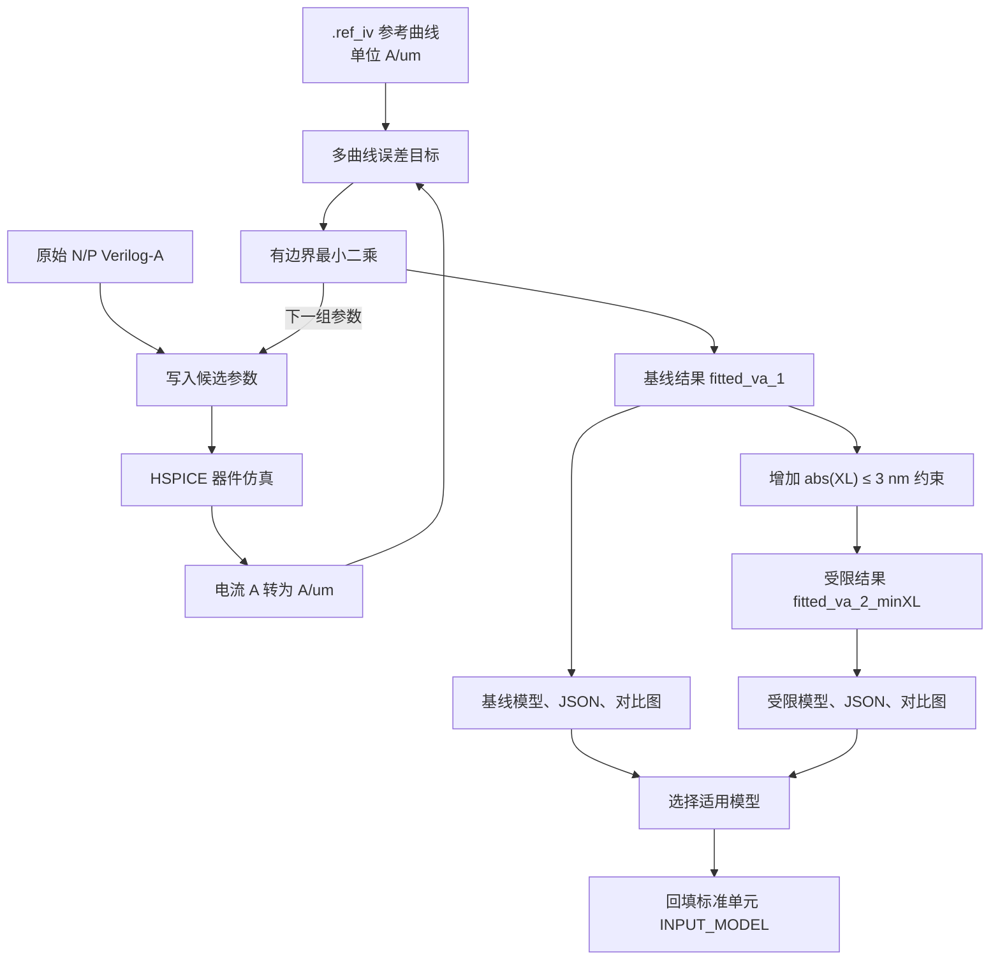
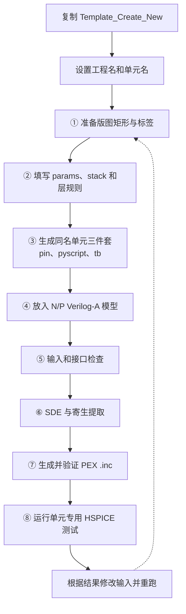

# AutoLDM

AutoLDM 是一个面向 DTCO 研究的自动化原型工程，将参考器件曲线、Verilog-A 紧凑模型、版图描述、三维结构生成、寄生参数提取和 HSPICE 标准单元验证连接成可重复执行的流程。

当前仓库中：

- `fitness/` 负责根据参考 `Id-Vg` 数据拟合 N/P 型 Verilog-A 模型；
- `FLOW/` 负责从版图和工艺描述生成 SDE 输入、执行 DRC、整理寄生参数，并生成可复用的 HSPICE 子电路；
- `FLOW/test/` 是目前文件最完整的参考工程；其中的电路连接由输入文件描述，生成器本身不绑定特定标准单元，可迁移到反相器、缓冲器、与非门、或非门及其他晶体管级标准单元。

> 当前定位是研究原型，而不是已经封装完成的一键式 PDK 工具。Sentaurus、寄生提取器和 HSPICE 的安装路径、许可证及远程计算环境仍需由使用者配置。

## 总体流程



这条链路把“器件模型标定”和“互连/电路验证”分开：`fitness` 生成的模型可以回填到任意标准单元工程，而一个标准单元的连接变化只需修改输入清单，不应修改 HSPICE 生成器源码。

## `FLOW/test` 参考工程

### 输入、处理和产物



各阶段职责如下：

| 阶段 | 脚本或目录 | 主要职责 |
|---|---|---|
| 版图转换 | `INPUT_MODEL/txt_gds_trans/` | 在 GDS 与矩形文本描述之间转换 |
| 几何预检查 | `gen_sde.py --validate-only` | 检查输入、层角色和几何一致性 |
| DRC | `gen_drc_report.py` | 检查宽度、间距、包围和接触规则 |
| 三维结构 | `gen_sde.py` | 生成 R/C 两种 SDE 命令与网格入口 |
| 寄生映射与 PEX | `gen_pex.py` | 计算 pin 级 R/C，生成 PEX `.inc` 与 validation deck |
| 标准单元测试 | `INPUT_MODEL/sdc_pyscript/<cell>.py` | 生成单元专用 deck、运行 HSPICE 并分析指标 |
| 统一执行 | `run_cell.py` | 检查参数、控制顺序并传播失败状态 |

### 标准单元拓扑为什么可以泛化

`gen_pex.py` 不包含某个具体电路的节点表，也不在 Python 中实例化固定数量的晶体管。电路特有信息由 `INPUT_MODEL/sdc_pin/<cell>.txt` 及其数值化版本完整表达：

```text
(FET){N1,P1}{S,G,D,B}
N1 S=n_internal G=IN D=OUT B=VSS L=default W=default NF=default
P1 S=p_internal G=IN D=OUT B=VDD L=default W=default NF=default

(PORT){IN,OUT,VDD,VSS}
IN=IN
OUT=OUT
VDD=VDD
VSS=VSS
```

同一文件还可包含：

- `(R){...}`：允许进入电阻网络的物理节点，以及需要计算的节点对；
- `(C){...}`：需要输出电容的节点及节点对；
- `(FET){...}{S,G,D,B}`：任意数量实例及每个实例的四端映射；
- `(PORT){...}`：子电路外部端口顺序及端口到内部物理节点的映射。

生成器遵循以下通用约定：

1. 实例名以 `N` 或 `P` 开头，用于选择对应的 Verilog-A 模块；
2. S/G/D/B 由清单显式指定，不根据节点名字猜测；
3. `L/W/NF=default` 从相应 VA 文件的参数默认值解析后显式写入实例；
4. 端口数、晶体管数、内部节点数和 R/C 元件数均不固定；
5. 物理接触标签和电路端口可以不同，通过 `PORT` 映射建立关系；
6. 更换标准单元时，主要修改版图、连接清单和测试场景，不修改生成器里的电路构造。



这种泛化仍有明确边界：当前版图文本以轴对齐矩形为主；每次生成使用一份 N 型和一份 P 型 VA 模块；实例命名必须满足 N/P 前缀约定；连接关系必须显式写入清单；当前 DRC 只覆盖脚本已经实现的规则类型。

## 分阶段运行示例

以下命令从仓库根目录运行。建议先逐阶段验证，再把它们包装成环境相关的总控脚本。

### 1. 预检查并生成 SDE 命令

```powershell
$Project = Resolve-Path ".\FLOW\test"

python "$Project\gen_sde.py" `
  "$Project\INPUT_MODEL\test_gds.txt" `
  "$Project\INPUT_MODEL\test_params.txt" `
  "$Project\INPUT_MODEL\test_stacked.txt" `
  --design-rules "$Project\INPUT_MODEL\test_design_rules.txt" `
  --validate-only `
  -o "$Project\SDE\test_sde.cmd"

python "$Project\gen_sde.py" `
  "$Project\INPUT_MODEL\test_gds.txt" `
  "$Project\INPUT_MODEL\test_params.txt" `
  "$Project\INPUT_MODEL\test_stacked.txt" `
  --design-rules "$Project\INPUT_MODEL\test_design_rules.txt" `
  -o "$Project\SDE\test_sde.cmd"
```

### 2. 统一生成 PEX、测试 deck 并运行 HSPICE

矩阵下载完成后，运行新的统一执行脚本。详细说明见 `FLOW/test/README_HSPICE_FLOW.md`。

```powershell
python "$Project\run_cell.py" `
  --name test `
  --cell sram1 `
  --input-model-dir "$Project\INPUT_MODEL" `
  --c-matrix "$Project\SDE\test_c_cMatrix.spi" `
  --r-matrix "$Project\SDE\test_r_cMatrix.spi" `
  --n-va "$Project\INPUT_MODEL\test_fet_n.va" `
  --p-va "$Project\INPUT_MODEL\test_fet_p.va" `
  --output "$Project\Hspice" `
  --strict-contact-face
```

该命令根据 `--cell` 自动选择同名 pyscript、bench 和 pin 文件，并依次完成 pin-RC、PEX、validation、单元 deck、HSPICE 执行和结果整理。

## `fitness`：Verilog-A 拟合

### 数据约定

- `.ref_iv/` 目录外层的 CSV 是乘系数后的参考电流密度，单位为 `A/um`；
- `.ref_iv/backup/` 中的 CSV 是最大电流归一到 1 的无量纲备份，不应直接作为绝对电流拟合目标；
- CSV 文件名中的 `44` 和 `48` 表示 CPP 工艺角，不表示栅长；参考图中的 `Lg` 为 12 nm；
- HSPICE 输出的器件电流单位为 A，拟合脚本按模型名义有效宽度换算为 `A/um` 后再与 CSV 比较；N/P 两类器件只需分别保证换算后的电流密度单位一致，不要求使用相同换算系数。

### 固定量与拟合量

当前脚本固定 `L`、`W`、`TGAA`、`NGAA`、`NF`、`NBODY`、`NSD` 和 N/P 各自的 `PHIG`，优化以下六个参数：

`U0`、`XL`、`DVTSHIFT`、`DeltaWGAA`、`DeltaTGAA`、`EOT_0`。

拟合目标同时包含低漏压和高漏压 `Id-Vg` 曲线，主要在对数电流域度量误差，并记录导通电流相对误差。输出是 CPP44、CPP48 各自完整的 N/P Verilog-A 模型、JSON 报告和对比图。

### 当前保留的两套结果

| 目录 | 用途 | XL 约束 |
|---|---|---|
| `fitness/fitted_va_1/` | 原始拟合结果，用作误差优先的基线 | 使用原始较宽边界 |
| `fitness/fitted_va_2_minXL/` | 在保留基线结果的前提下重新拟合 | `abs(XL) <= 3 nm` |

每套目录均包含 `cpp44/`、`cpp48/` 的完整 N/P VA 文件、`fit_report.json` 和 `fit_comparison.png`。受限拟合中四个工艺角的 `XL` 都满足 3 nm 限制；这是以一定拟合误差增长换取更小 `XL` 的折中。



示例：

```powershell
python .\fitness\fit_hspice_va.py `
  --hspice "C:\path\to\hspice.exe" `
  --output-dir fitted_va_new

python .\fitness\fit_hspice_va.py `
  --hspice "C:\path\to\hspice.exe" `
  --minimize-xl `
  --xl-limit-nm 3 `
  --output-dir fitted_va_new_minXL
```

`--output-dir` 的相对路径以 `fitness/` 为基准，并且脚本会拒绝写到该目录之外。

> 当前仓库中的原始模型文件名是 `original_nfet.va` 和 `original_pfert.va`，而 `fit_hspice_va.py` 仍固定查找 `fitness/test_fet_n.va` 与 `fitness/test_fet_p.va`。因此重新拟合前必须先统一这组文件名，或把脚本改为接受显式 N/P 模型路径；否则会在启动检查阶段得到 `FileNotFoundError`。现有两套拟合结果不受此命名差异影响。

先运行 `python .\fitness\fit_hspice_va.py --help` 查看恢复计算、仅重绘和中间文件保留等选项。日常运行不建议开启中间文件保留，以免产生大量临时 HSPICE deck 和输出。

当前拟合只标定 DC `Id-Vg`。电荷、电容、瞬态、高场效应和更独立的 DIBL 控制尚未通过这些数据完整约束；接近参数边界的结果应视为数值工艺角，而不是唯一的物理参数提取值。

## 仓库目录结构

```text
AutoLDM/
├─ FLOW/
│  ├─ test/                    当前最完整的参考工程
│  ├─ Template_Create_New/     新工程骨架
│  ├─ Template_Mini/           最小命令示例
│  ├─ StandardCells_DataBase/  标准单元定义与引脚资料
│  ├─ FLOW.cmd                 本机/远程流程编排示例
│  └─ cleanup_obsolete_swb_files.sh
├─ fitness/                    参考曲线、拟合器、模型、报告和图片
├─ Database/                   标准单元 GDS 与相关数据库资料
├─ .Referance_Paper/           参考论文、提取文本和渲染图片
├─ .paper_publish/             论文投稿、会议与出版规划资料
├─ PKU_TODO/                   阶段任务、里程碑和流程草图
├─ .readme/                    内部进展、Git 与 TODO 记录
├─ .agents/                    自动化代理的本地配置
├─ .history/                   编辑历史或阶段性副本
├─ .trash/                     暂存的废弃文件
├─ __pycache__/                Python 运行缓存
└─ readme.md                   本文件
```

### 主要目录说明

- `FLOW/test/INPUT_MODEL/`：工程的源输入。应优先在这里修改几何、工艺、规则、连接、VA 模型和测试描述。
- `FLOW/test/SDE/`：SDE 命令、网格相关产物以及原始寄生矩阵。大部分内容可以由上游输入再生成。
- `FLOW/test/Hspice/`：数值化连接文件、生成的 `.inc`、验证 deck、测试 deck 和仿真结果。
- `FLOW/test/OUTPUT/`：DRC 等面向人的检查报告。
- `FLOW/Template_Create_New/`：复制并重命名后可作为新标准单元工程起点；模板应保持无特定拓扑的生成逻辑。
- `FLOW/Template_Mini/`：保留最短的 SDE 生成命令，适合检查环境和参数格式。
- `FLOW/StandardCells_DataBase/` 与 `Database/`：前者偏流程所需的单元定义和引脚信息，后者偏原始版图及数据库资产。
- `.Referance_Paper/`、`.paper_publish/` 和 `PKU_TODO/`：研究资料与项目管理内容，不是运行时依赖。
- `.history/`、`.trash/`、`__pycache__/`：不应作为权威输入，也不建议纳入批量发布产物。

## 新建一个标准单元工程



迁移时建议遵循以下原则：

1. 复制模板目录，不复制已有单元的内部节点假设；
2. 统一工程文件名前缀，但脚本调用使用相对路径或显式命令行参数；
3. 让版图标签承担物理定位，让 `FET`/`PORT` 段承担电路语义；
4. 每次修改连接后先生成零偏置验证 deck，再进入功能仿真；
5. 将测试平台视为消费者，生成的 `.inc` 本身是可独立实例化的标准单元器件；
6. 把可再生成产物与人工维护输入分开，便于自动化和版本控制。

## 环境与依赖

| 类别 | 用途 |
|---|---|
| Python 3 | 所有文本生成、检查、矩阵映射和拟合脚本 |
| NumPy、SciPy、Matplotlib | 数值优化、数据处理和拟合绘图 |
| HSPICE | Verilog-A 器件仿真、`.inc` 编译与电路验证 |
| Sentaurus Structure Editor / 网格工具 | 三维结构和网格生成 |
| 寄生参数提取环境 | 生成 R/C 矩阵 |
| PowerShell、SSH/SCP | Windows 本地编排及可选的远程运行 |

`FLOW/FLOW.cmd` 记录了当前环境的一种编排方式，但其中包含机器相关的绝对路径、工程名和远程配置，不能直接用于其他环境。脚本化时应把这些内容改成命令行参数、配置文件或环境变量，并使用 SSH 密钥或安全的凭据管理方式，不要在仓库脚本中保存明文口令。还应以各工具的实际目录为准核对版图转换脚本路径。

## 建议的自动化检查

在把流程接入持续集成或批处理前，至少执行：

1. `gen_sde.py --validate-only` 返回 0；
2. DRC 报告没有未豁免的 `ERROR`；
3. pin 清单中的每个 FET 均有完整 S/G/D/B，每个端口均可映射到有效节点；
4. R/C 矩阵映射没有悬空请求或意外节点收缩；
5. 自动生成的零偏置验证 deck 能由目标 HSPICE 版本编译；
6. 测试 runner 输出明确的成功/失败状态和可追溯清单；
7. 拟合模型附带 `fit_report.json`、对比图和参考数据单位说明；
8. 生成产物能够由受版本控制的输入重新构建。

这样可以把某个完整参考工程沉淀为通用流程，同时避免把示例单元的节点命名、器件数量或测试激励固化到生成脚本中。


